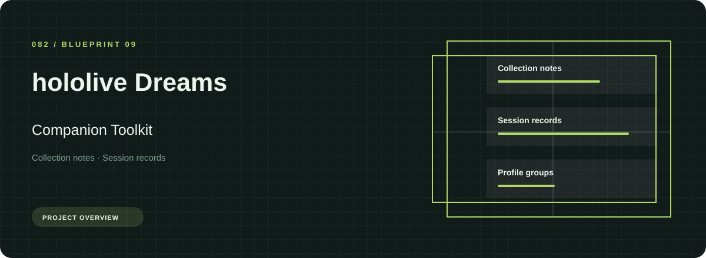
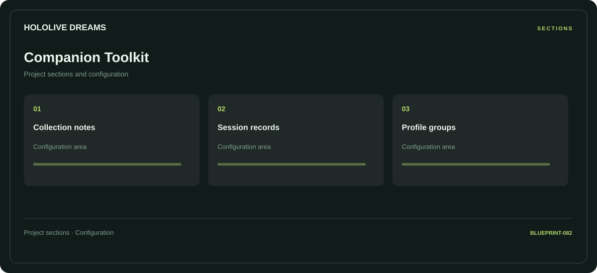

# ⚡ hololive Dreams Companion Toolkit

**Collection notes · Session records · Profile groups**

## ⚡ Features

Use the hololive Dreams companion toolkit workspace to move between collection notes, session records, and profile groups. The section map below gives each part a clear place in the project.

### ⚙️ Collection notes

A dedicated section for collection notes and the configuration details associated with that area.

### 🧩 Session records

Session and activity information grouped by the task or context it belongs to.

### ⌨️ Profile groups

Related settings collected into named groups for a clearer configuration workflow.

## 🖥️ Project navigation

## 📥 Download

The button and cover open the project's download page. Use the information supplied with the downloaded package for installation and release-specific requirements.

## 📚 Project documentation

- [Feature reference](docs/FEATURES.md)
- [Download information](docs/DOWNLOAD.md)
- [Project page](index.html)

---

hololive Dreams Companion Toolkit · Program documentation and download information.
